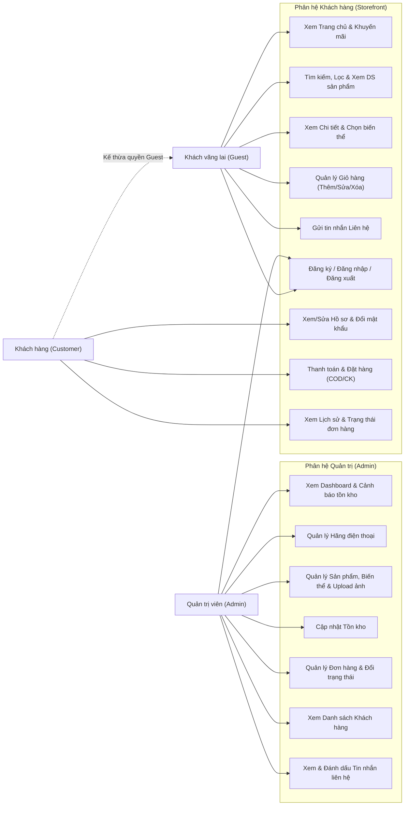

# Sơ đồ Use Case — Phone Sales Management System (NovaPhone)

## 1. Sơ đồ tổng quan các Actor và Ca sử dụng (Mermaid)

---

## 2. Mô tả tóm tắt theo từng Actor

### A. Khách vãng lai (Guest)

- Xem trang chủ (banner, hãng điện thoại, sản phẩm nổi bật, khuyến mãi).
- Tìm kiếm sản phẩm theo tên/chip, lọc theo hãng, khoảng giá, RAM, bộ nhớ trong, sắp xếp và phân trang.
- Xem chi tiết điện thoại, bảng thông số kỹ thuật và chọn màu/dung lượng để xem giá & tồn kho thực tế.
- Thêm sản phẩm vào giỏ hàng tạm (theo session), cập nhật số lượng hoặc xóa khỏi giỏ.
- Gửi form liên hệ và thực hiện đăng ký/đăng nhập.

### B. Khách hàng đã đăng nhập (Customer)

- Thực hiện toàn bộ chức năng của Guest.
- Thực hiện thanh toán (`checkout.php`): nhập địa chỉ giao hàng, chọn COD hoặc chuyển khoản mô phỏng, xác nhận tạo đơn hàng (hệ thống tự động trừ tồn kho).
- Xem/cập nhật thông tin cá nhân, đổi mật khẩu tại `profile.php`.
- Theo dõi lịch sử các đơn hàng đã đặt và trạng thái xử lý (`pending`, `confirmed`, `shipping`, `completed`, `cancelled`).

### C. Quản trị viên (Admin)

- Đăng nhập bằng tài khoản có `role = 'admin'` để truy cập khu vực `/admin/`.
- Theo dõi Dashboard: tổng số đơn hàng, tổng doanh thu, cảnh báo sản phẩm sắp hết hàng (`stock_qty <= 5`).
- Quản lý hãng điện thoại (`brands.php`), quản lý sản phẩm & các biến thể kèm upload ảnh (`products.php`, `product-form.php`).
- Xem và cập nhật nhanh số lượng tồn kho (`inventory.php`).
- Xem chi tiết đơn hàng và cập nhật trạng thái giao hàng (`orders.php`, `order-detail.php`).
- Xem danh sách khách hàng (`customers.php`) và tiếp nhận tin nhắn liên hệ (`messages.php`).
